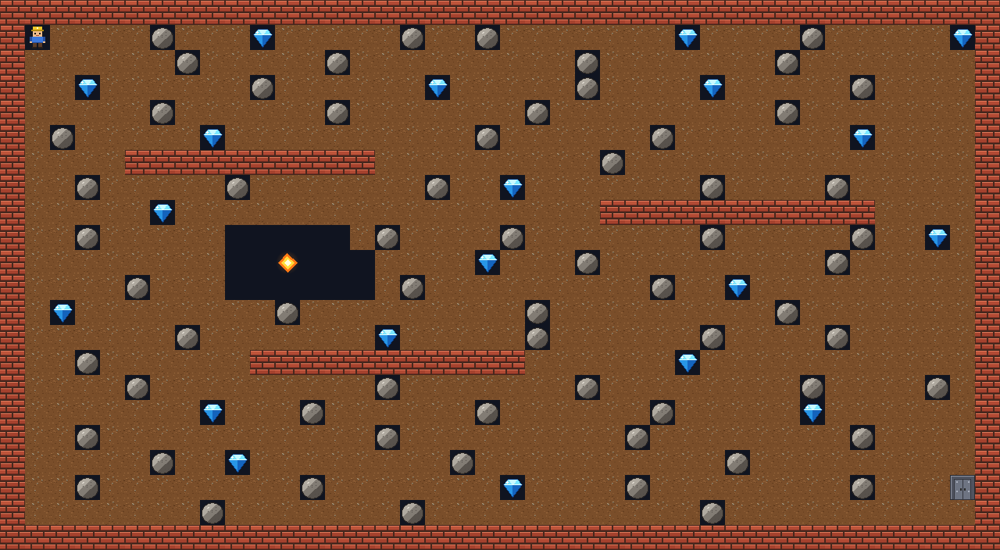

# gm_boulder_dash

A simple Boulder Dash game made in GameMaker / GML, for teaching children.

## How to play

- Arrow keys (or WASD) — move, dig through dirt, push boulders left or right.
- Collect enough diamonds (see the counter in the top left corner) and the exit opens.
- Walk into the open exit to go to the next level.
- Don't stand under a falling boulder and don't touch the fireflies!
- `R` — restart the level.

## How it works

Everything lives on a grid of 32×32 pixel cells (`TILE` in the `Grid` script)
and moves exactly one cell at a time.

| Object | What it does |
|--------|--------------|
| `o_Player` | Step: reads the keys, then digs `o_Dirt`, collects `o_Diamond`, pushes `o_Boulder` or stops at `o_Wall`. |
| `o_FallingBase` | Parent of `o_Boulder` and `o_Diamond`. Alarm 0: fall down, crush the player or a firefly, roll off round things. |
| `o_Firefly` | Alarm 0: fly straight ahead, turn right when something is in the way. |
| `o_GameController` | Counts diamonds, opens `o_Exit`, draws the counter, restarts the room. `diamonds_needed` is set per room. |
| `o_Explosion` | Plays its animation and disappears. |
| `o_WinText` | The "You win!" screen. |

The most used GameMaker functions:
`place_meeting`, `place_empty`, `instance_place`, `instance_destroy`,
`instance_create_layer`, `audio_play_sound`, `room_goto_next`, `room_restart`.

## Lessons example

With 1.5 hours per lesson.

1. Project, sprites `s_Wall` and `s_Dirt`, objects `o_Wall` and `o_Dirt`, room with a 32×32 grid, paint a cave.
   `Grid` script with `TILE`. `o_Player` moves one cell with the arrow keys and digs dirt.
2. Boulders: `o_FallingBase` with Create and Alarm 0 — first only falling down, then rolling off.
   `o_Boulder` as its child. The player pushes boulders.
3. Diamonds: `o_Diamond` as the second child of `o_FallingBase`. `o_GameController` with `AddDiamond()`,
   the diamond counter (Draw GUI), `o_Exit` and going to the next room.
4. Danger: a falling boulder crushes the player, `Die()`, `o_Explosion`, restarting the room. Sound effects.
5. `o_Firefly` enemy, camera that follows the player (Viewport 0), second level, win room.

## Assets

- Graphics: own pixel art, drawn by `tools/make_art.py` (Python + Pillow). Free to use.
- Sounds: made with sfxr (https://sfxr.me, public domain), generated by `tools/make_sfx.js`
  (`npm install jsfxr`, then `node make_sfx.js <output folder>`).
- Fonts: Bernard MT Condensed, the same as in Farm Builder.
